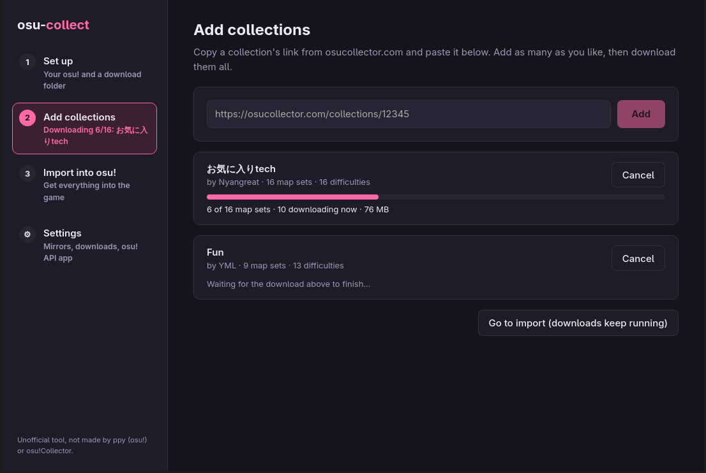
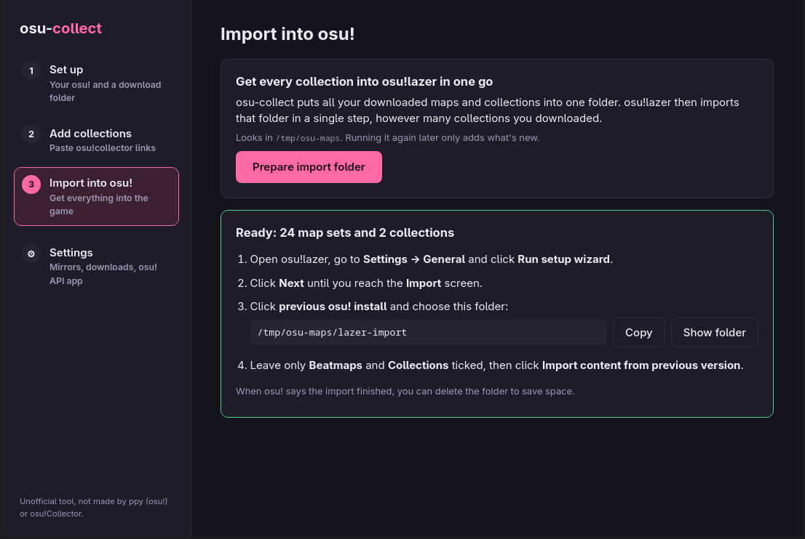

<div align="center">

<h1>osu-collect</h1>

<p><b>Download osu!collector collections and get them into osu!, from a desktop app or your terminal</b></p>

[Features](#features) · [Install](#installation) · [Desktop app](#desktop-app) · [Terminal app](#terminal-app) · [Import](#importing-into-osu) · [FAQ](#faq) · [Docs](#documentation) · [What's next](#whats-next)

</div>

osu-collect downloads every map in an [osu!collector](https://osucollector.com) collection from public beatmap mirrors, switching mirrors when one is busy or down. It also writes a `collection.db`, so the collection itself shows up in osu!, not just the maps. You can check a collection again later and fetch only what's new.

> [!NOTE]
> **This is a personal fork** of [uwuclxdy/osu-collect](https://github.com/uwuclxdy/osu-collect), maintained by DesireThings. It adds a desktop app and a one-step osu!lazer import for any number of collections, and it never asks for your osu! login. Upstream isn't responsible for anything here.
>
> osu-collect is an unofficial community tool. It isn't made, endorsed or supported by ppy (the makers of osu!) or by osu!Collector; their names are used only to say what it works with.

<div align="center">




</div>

## Features

- **Desktop app:** three steps (set up, add collections, import), with buttons and text boxes and plain-language messages. See [Desktop app](#desktop-app).
- **Every collection into osu!lazer in one go:** however many collections you download, lazer imports them all, maps and collections, in a single pass of its setup wizard.
- **No account needed:** paste a collection link and go.
- **Nine mirrors with failover:** when a mirror rate-limits, the map waits and retries while the rest keep downloading. You can also skip the stuck ones and fetch them later. See [Mirrors](https://github.com/DesireThings/osu-collect/wiki/Mirrors).
- **A real collection:** a verified `collection.db` next to the maps.
- **Keep collections up to date:** check a downloaded collection again and fetch only new or missing maps.
- **Find maps without a collection** (terminal app): search by per-difficulty criteria through the osu! API or nzbasic's community database. See [Finding maps](https://github.com/DesireThings/osu-collect/wiki/Finding-Maps).

## Installation

> [!NOTE]
> osu-collect is in early access (version 0.x). The Windows and macOS desktop installers are built and checked automatically but haven't been run on a real Windows PC or Mac yet; please [open an issue](https://github.com/DesireThings/osu-collect/issues/new) if one doesn't work.

**Desktop app:** download the file for your system from the [latest release](https://github.com/DesireThings/osu-collect/releases/latest):

| System | File |
|---|---|
| Windows 10/11 | `…-windows-x64-setup.exe` |
| Mac with Apple Silicon | `…-macos-arm64.dmg` |
| Linux | `…-linux-x64.AppImage`, or `…-linux-amd64.deb` on Debian/Ubuntu |

The apps aren't signed with a paid certificate, so the first start shows a warning: on Windows, **More info → Run anyway**; on macOS, **System Settings → Privacy & Security → Open Anyway**. The desktop app doesn't update itself yet; install a new version over the old one.

**Terminal app** (updates itself):

Linux x64 / macOS Apple Silicon:

```bash
curl -fsSL https://raw.githubusercontent.com/DesireThings/osu-collect/main/install.sh | bash
```

Windows x64 (PowerShell):

```powershell
iwr https://raw.githubusercontent.com/DesireThings/osu-collect/main/install.bat -OutFile "$env:TEMP\osu-install.bat"; & "$env:TEMP\osu-install.bat"; Remove-Item "$env:TEMP\osu-install.bat"
```

Or download `osu-collect-linux-x64`, `osu-collect-windows-x64.exe` or `osu-collect-macos-arm64` from the release. Building from source, uninstalling and more: [Installation](https://github.com/DesireThings/osu-collect/wiki/Installation).

## Desktop app

1. **Set up:** pick osu!lazer or osu! stable (your osu! folder is found automatically when it's in the usual place) and a download folder.
2. **Add collections:** paste osucollector.com links, check the names and map counts, then **Download** or **Download all**. Collections download one after another; you can cancel, retry, or skip map sets that are waiting on a busy mirror.
3. **Import into osu!:** for lazer, **Prepare import folder**, then follow the four steps the app shows. For stable, see [below](#importing-into-osu).

**Settings** covers mirrors (on/off, order, your own mirror links), download options and your own osu! API app. Full guide: [Desktop app](https://github.com/DesireThings/osu-collect/wiki/Desktop-App).

## Terminal app

```bash
osu-collect
```

Paste a collection link, pick a folder, press <kbd>↵</kbd>. The get maps tab has two more sources: **find** searches maps by criteria, with no collection needed; **update** checks collections you downloaded and fetches only what's missing. Press <kbd>?</kbd> in the app for every key. Guides: [Usage](https://github.com/DesireThings/osu-collect/wiki/Usage), [Finding maps](https://github.com/DesireThings/osu-collect/wiki/Finding-Maps), [Updating collections](https://github.com/DesireThings/osu-collect/wiki/Updating-Collections), [Keybindings](https://github.com/DesireThings/osu-collect/wiki/Keybindings).

## Importing into osu!

<details open>
<summary><b>osu!lazer</b> (also Torii and other lazer builds)</summary>

Build one import folder from every collection you've downloaded: **Import into osu! → Prepare import folder** in the desktop app, <kbd>l</kbd> on the terminal app's downloads tab, or `osu-collect lazer-import`. Then:

1. In osu!lazer, **Settings → General → Run setup wizard**, and **Next** until the **Import** screen.
2. Set **previous osu! install** to the import folder.
3. Leave only **Beatmaps** and **Collections** ticked, then click **Import content from previous version**.

All maps and collections come in at once. Building the folder again after more downloads only adds the new ones.

</details>

<details>
<summary><b>osu! stable</b></summary>

Drag the downloaded `.osz` files into osu!, then merge each folder's `collection.db` into yours with [Collection Manager](https://github.com/Piotrekol/CollectionManager). With no collections of your own yet, you can copy the generated `collection.db` over yours instead. Back yours up first either way.

</details>

More detail: [Importing into osu!](https://github.com/DesireThings/osu-collect/wiki/Importing-into-osu).

## Configuration

Both apps share one optional config file. The desktop app's Settings page and the terminal app's config tab edit it for you.

| OS | Path |
|---|---|
| Linux | `~/.config/osu-collect/config.toml` |
| macOS | `~/Library/Application Support/osu-collect/config.toml` |
| Windows | `%APPDATA%\osu-collect\config.toml` |

See [config.toml.example](config.toml.example) and [Configuration](https://github.com/DesireThings/osu-collect/wiki/Configuration).

## FAQ

**Do I need an osu! account?**
Not to download collections: osu-collect never asks for your osu! login. Only the terminal app's find, when it searches through the osu! API, needs an API app of your own, which you make on your osu! account page; see [Finding maps](https://github.com/DesireThings/osu-collect/wiki/Finding-Maps#your-osu-api-app).

**Where do the maps come from?**
The collection's details come from osu!Collector; the maps come from public beatmap mirrors, not from osu!'s servers. Which mirrors, and in what order, is up to you in the settings.

**A download says map sets are "waiting for a free mirror". Is it stuck?**
No. Every mirror that has those maps is rate-limiting, so they're retried once a mirror frees up, usually within minutes. In the desktop app you can **Skip these for now** and get them later with **Check again**.

**I also use uwuclxdy's osu-collect. Can I keep both?**
Yes, but they share one settings folder. This version deletes a saved osu!lazer login from the original, because it no longer signs in through osu!lazer's client. The original keeps updating from its own releases.

**Does osu!Collector have its own app?**
Yes, the [osu!Collector desktop client](https://osucollector.com/app). Its subscription pays for the site that hosts every collection osu-collect reads. If you use osu!Collector a lot, consider supporting it.

## Documentation

The full guide is the [osu-collect wiki](https://github.com/DesireThings/osu-collect/wiki). Its pages live in [`wiki/`](wiki/) in this repository and are copied to the GitHub wiki automatically, so if a wiki link doesn't work yet, read the same page in [`wiki/`](wiki/Home.md).

## What's next

- [x] First release: packaged desktop app and terminal binaries for Linux, Windows and macOS (0.1.0)
- [ ] Desktop app: find and update screens (terminal-only today)
- [ ] Desktop app: tell you when a new version is out
- [ ] osu! stable: add maps and collections straight into stable (with a backup, while osu! is closed), so Collection Manager isn't needed
- [ ] Export collections as `.osdb`, Collection Manager's format, for sharing and merging
- [ ] Save find results as a collection, like [Batch Beatmap Downloader](https://github.com/nzbasic/batch-beatmap-downloader) does
- [ ] osu!Stats collections as a source (upstream [#3](https://github.com/uwuclxdy/osu-collect/issues/3))
- [ ] Collections from a player's top plays, using your own osu! API app (like Collection Manager's generator)

## Alternatives

| Tool | What it does |
|---|---|
| [osu!Collector desktop client](https://osucollector.com/app) | osu!Collector's own paid app: downloads from its servers and adds collections to osu! for you. |
| [Batch Beatmap Downloader](https://github.com/nzbasic/batch-beatmap-downloader) | Downloads maps matching filters and tags (farm, stream) rather than osu!collector collections. |
| [osu-collector-dl](https://github.com/roogue/osu-collector-dl) | Windows command-line downloader for osu!collector; can write a `.osdb` for Collection Manager. |
| [OsuCollectionDownloader](https://github.com/waylaa/OsuCollectionDownloader) | Command-line downloader that extracts into your Songs folder and can write a `.osdb`. |
| [Collection Manager](https://github.com/Piotrekol/CollectionManager) | Edits, merges and exports osu! collections, and downloads missing maps from osu! with your account. Pairs well with osu-collect for stable. |

## Acknowledgments

- [uwuclxdy/osu-collect](https://github.com/uwuclxdy/osu-collect): the project this fork is built on, including the terminal app and the bundled [osu-downloader](osu-downloader/) library
- [osu!Collector](https://osucollector.com): where the collections come from
- [osu-db](https://crates.io/crates/osu-db) (osu! stable's database), [Realm](https://github.com/realm/realm-cpp) (osu!lazer's database), [ratatui](https://ratatui.rs) (terminal app), [Tauri](https://tauri.app) and [Svelte](https://svelte.dev) (desktop app)
- Inspired by [Batch Beatmap Downloader](https://github.com/nzbasic/batch-beatmap-downloader)

## License

Licensed under either of [MIT](LICENSE-MIT) or [Apache-2.0](LICENSE-APACHE) at your option, like upstream. Each release includes `THIRD-PARTY-LICENSES.txt` (terminal app) and `THIRD-PARTY-LICENSES-desktop.txt` (desktop app) with the licences of everything built into them; the desktop app also shows its list under **Settings → About**. Unless you explicitly state otherwise, any contribution intentionally submitted for inclusion in this work shall be dual licensed as above, without any additional terms or conditions.
